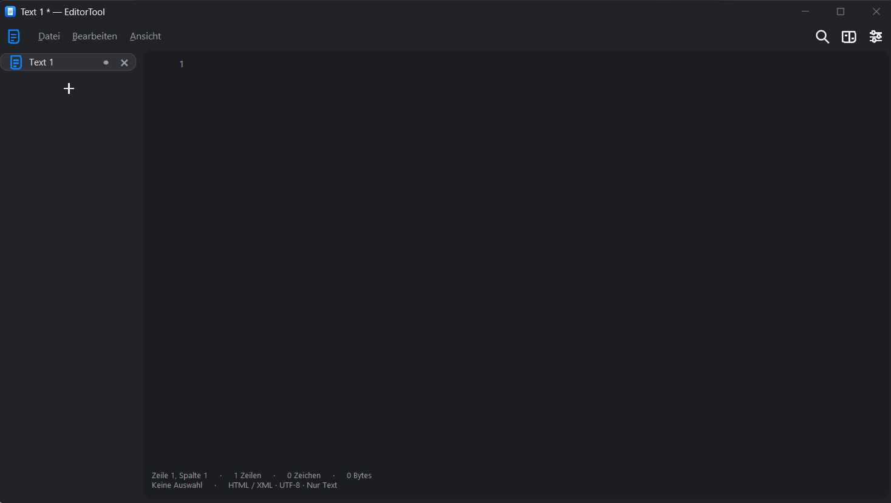

<h1 align="center">EditorTool</h1>
<h3 align="center">A lightweight native editor for text, code and images</h3>

---

<p align="center">
  
  <br/><br/>
  <a href="LICENSE"></a>
  <a href="https://github.com/OnlySecci/EditorTool/releases/latest"></a>
  <a href="https://github.com/OnlySecci/EditorTool/actions/workflows/build-release.yml"></a>
  <br/>
  <a href="https://github.com/OnlySecci/EditorTool/issues"></a>
  <a href="https://github.com/OnlySecci/EditorTool/releases.atom"></a>
</p>

---

EditorTool is a native desktop editor that brings plain text, source code and inline images into one workspace. It runs on Windows, Linux and macOS, with x64 and ARM64 packages for every platform. Built in Rust with FLTK, it uses no embedded browser runtime and waits for operating-system events while idle.

Keep several documents open in tabs, compare text side by side, or split the workspace into independent views. Paste text without carrying over fonts, colours or rich-text formatting. Add images when you need them, and share selected documents with devices on your local network or VPN.

EditorTool is free software released under [The Unlicense](LICENSE). No account or cloud service is required. Documentation and development discussions are maintained in English; the application's interface can be selected separately.

**Get started**<br/>
Download a package from [Releases](https://github.com/OnlySecci/EditorTool/releases/latest), follow the [installation instructions](#installation), or [build from source](#development).

**Report a problem**<br/>
Open a [GitHub issue](https://github.com/OnlySecci/EditorTool/issues). Include your operating system, architecture, app version and the steps that led to the problem. You can export a diagnostic log from the Help menu; review it before uploading.

**Contribute**<br/>
Read the [contribution guide](CONTRIBUTING.md). Improvements to code, documentation and packaging are welcome.

**Suggest an improvement**<br/>
Describe the workflow and expected behaviour in a [feature request](https://github.com/OnlySecci/EditorTool/issues/new).

---



*Owner-provided screenshot from V1.0. Later versions include additional features and interface changes.*

## EditorTool Desktop

This repository contains the native desktop application, packaging scripts and release workflows. Each release provides Windows installers and portable archives, Linux Flatpak/DEB/RPM/portable packages, and macOS DMG/ZIP packages for both supported architectures.

### Features

- Multiple windows and tabs, horizontal or resizable vertical tab lists, and side-by-side or stacked split views.
- Plain-text clipboard handling, optional line wrapping, syntax colours, line numbers and selection statistics.
- Find and replace, undo and redo, text comparison, zoom and custom keyboard shortcuts.
- Text and inline images in `.etdoc` documents; ordinary UTF-8 files for plain text and code. Resize images using their corner handles.
- Session recovery for open tabs, unsaved content, images and cursor positions, plus local history before files are overwritten.
- Explicitly approved document sending and synchronisation over private networks and VPNs, with conflict handling and a five-second writing pause before publishing local changes.
- LAN/VPN interface selection, editable clients, connection status and filterable communication logs.
- In-app updates using signed package metadata, encrypted local content, recovery-key export, adjustable sync quotas, storage cleanup and a permissions overview.

See the [release notes](RELEASE_NOTES.md) and [changelog](CHANGELOG.md) for version-specific changes and limitations.

## Installation

Download the package matching your operating system and processor from [the latest release](https://github.com/OnlySecci/EditorTool/releases/latest).

| Platform | x64 and ARM64 packages |
| --- | --- |
| Windows | Setup EXE or portable ZIP |
| Fedora / Nobara | RPM or Flatpak |
| Ubuntu / Debian | DEB or Flatpak |
| Other Linux distributions | Flatpak or portable TAR.GZ |
| macOS | DMG or ZIP containing the app bundle |

### Windows

Run the setup EXE to install for the current user under `%LOCALAPPDATA%\Programs\EditorTool`. The app appears in Windows Settings under installed apps and can be associated with `.etdoc` files. Uninstalling leaves the session cache in place.

For portable use, extract the ZIP and keep `portable.txt` beside the executable. Settings and cached documents then live in the adjacent `Data` directory.

### Linux

Install the RPM or DEB using your distribution's package manager. For Flatpak, run the following command with the downloaded bundle's actual filename:

```sh
flatpak install --user ./EditorTool-VERSION-linux-ARCH.flatpak
flatpak run com.github.OnlySecci.EditorTool
```

The Flatpak bundle includes runtime repository information; the app is not published on Flathub. File selection uses desktop portals. Native Linux builds use X11 or XWayland.

### macOS

Open the DMG and drag EditorTool into Applications. Choose `x64` for Intel Macs and `arm64` for Apple Silicon.

### Package verification and updates

Release packages do not currently have Windows or Apple developer certificates. macOS bundles have an ad-hoc signature and are not notarised. Signed update metadata is separate from operating-system code signing.

Releases include `SHA256SUMS.txt`, `update-metadata.json` and `update-metadata.sig`. Since V1.5.0, the updater requires Ed25519-signed metadata matching its pinned public key, verifies package size and SHA-256, rejects expired metadata and blocks versions older than a higher version it has already seen. See [update signing](docs/update-signing.md).

Use the Help menu to check manually for updates. Startup checks and automatic installation are separate settings; automatic installation is off by default. System-wide installations may require administrator approval.

## Interface Languages

Choose English, German, French, Italian, Spanish, Portuguese, Dutch, Polish, Turkish or Ukrainian in Settings → General → Interface language, then restart EditorTool. The initial catalogs translate menus and common controls; detailed technical messages and untranslated text fall back to English. Documents and file paths are never translated. Project documentation and release notes remain in English.

## Documents and Local Data

Plain-text and code files remain UTF-8 files. Use `.etdoc` to save text and embedded images together. Image resizing changes display dimensions while preserving the original image data.

The session cache saves changes in the background after a short delay and restores open work on the next launch. It does not overwrite original files. Explicitly closed tabs stay closed, while closed extra windows can be restored from the File menu. Undo history is not saved across restarts. A forced shutdown can only recover the last completed cache write.

| Platform | Settings and cached data |
| --- | --- |
| Windows | `%APPDATA%\EditorTool` |
| Linux | `$XDG_CONFIG_HOME/EditorTool`, or `~/.config/EditorTool` |
| macOS | `~/Library/Application Support/EditorTool` |
| Portable mode | `Data` beside the executable |

From V1.5.3, session contents, local history, sharing metadata/content and device keys are encrypted with authenticated AES-256-GCM. Installed profiles protect their master key with Windows DPAPI, macOS Keychain or Linux Secret Service. Portable profiles use a password; an unavailable credential service offers an explicit password option. Settings and diagnostic logs are outside the encrypted content vault and still require care when sharing.

Migration runs after a successful unlock and preserves the device identity. Unlock failure leaves protected data locked rather than replacing keys or using plaintext. Export a password-encrypted recovery key from Settings → Security and keep it outside the profile. Copying the data directory alone is insufficient to recover an OS-bound key. Older app versions cannot read migrated storage. Original saved documents retain their normal format; cleanup does not securely erase filesystem blocks or old backups. See [security and recovery](docs/security.md).

## Sending and Synchronisation

Enable sending and sync in Settings, then add the other device's private IP address and port. The default is **TCP 51473**. Select local LAN/VPN interfaces if required. EditorTool supports routed private networks and VPNs, rejects public destination IPs, and does not configure routes or firewall rules.

Devices approve each other's identity, and recipients separately accept document offers. A trusted device is not automatically granted access to every document. Sync uses signed revision provenance, verified parent counters and content hashes to detect concurrent changes without relying on matching system clocks. Automatic saving is selected per document; recognised code and startup-sensitive targets require separate, exact-target consent. Upgrade all peers to V1.5.3 and share old documents as fresh groups. Old groups are archived without deleting cached editor contents.

Connections require **TLS 1.3, AES-256-GCM and hybrid X25519 + ML-KEM-768 key exchange**. Device identity and revision signatures remain classical ECDSA P-256. The persistent private key is encrypted under the protected local master key. Its identity remains stable across ordinary reconnects; fresh TLS key exchange protects connections. Explicit identity replacement is available in Security settings and requires restart and renewed approval. A stolen, unlocked private identity can still permit impersonation until the old fingerprint is revoked on every peer. OS protection cannot prevent access by an attacker controlling the same unlocked user account.

**V1.5.4:** The version/conflict view offers **Force sync main** to choose a common main revision. Signed logical generations prevent older offline branches from replacing it; deterministic tie-breaking handles concurrent force decisions. Unsent local drafts are preserved in separate recovery tabs before replacement. All peers need the compatible V1.5.4 protocol; V1.5.3 groups and signatures are preserved during upgrade. See [Force sync main](docs/force-sync-main.md) for ordering, logs and limitations.

Connection status reflects the last completed exchange. Checks normally wait ten seconds after a round, or one second while work is pending; slow peers and timeouts can extend this. Manual checking is available. Disconnect notices appear inside the editor. The communication log records message types, byte counts and device/network metadata, without document contents or private keys; export is explicit. A pseudonymised export removes device names, addresses and fingerprints while retaining timestamps and traffic sizes.

## Development

Read [CONTRIBUTING.md](CONTRIBUTING.md) before making changes. Keep the native architecture, low idle overhead, plain-text clipboard behaviour and explicit sharing consent.

### Prerequisites

- [Rust stable](https://rustup.rs/), version 1.90 or newer. `Cargo.lock` pins dependencies.
- Windows: CMake, Git and Visual C++ tools for your target architecture when building FLTK from source. Set `CARGO_BUILD_TARGET` to `x86_64-pc-windows-msvc` or `aarch64-pc-windows-msvc`.
- Linux: C++ compiler and X11, Pango, Cairo and Fontconfig development packages; packaging tools for the desired formats.
- macOS: Xcode Command Line Tools and the Rust target matching the intended architecture.

### Clone the repository

```sh
git clone https://github.com/OnlySecci/EditorTool.git
cd EditorTool
```

### Build and package

| Platform | Release build | Packaging |
| --- | --- | --- |
| Windows | `scripts/build-windows.ps1` | `scripts/package-windows.ps1 -PortableOnly` |
| Linux | `bash scripts/build-linux.sh` | `bash scripts/package-linux.sh` and `bash scripts/package-flatpak.sh` |
| macOS | `bash scripts/build-macos.sh` | `bash scripts/package-macos.sh` |

For local Windows setup generation, point `NSIS_COMPILER` at an installed NSIS compiler. GitHub Actions creates setup EXEs with NSIS on Linux after the native Windows builds.

The release workflow builds all six operating-system/architecture combinations and publishes only after the full package set is available. At the project owner's request, the current workflow performs builds and packaging without automated, interactive or installation tests.

### Resource usage and limits

EditorTool uses Rust and FLTK without a web runtime. UI updates are event-driven; background saving and syntax colouring are delayed after changes. No measured RAM or CPU benchmark is currently published.

Documents are limited to 64 MiB. Image input is limited to 32 MiB compressed, 32,768 pixels per side, 64 images and a total of 40 megapixels per document. Images increase memory and cache usage. Syntax colouring is lexical and disabled above 4 MiB per text area. Large text comparisons become coarser above 16 MiB; images are not visually compared. Character counts use Unicode code points.

## License

Original project files are released under **[The Unlicense](LICENSE)**, also available as [UNLICENSE](UNLICENSE). Dependencies retain their own licences; their notices are included in [`third-party-licenses`](third-party-licenses) and distributed packages.
