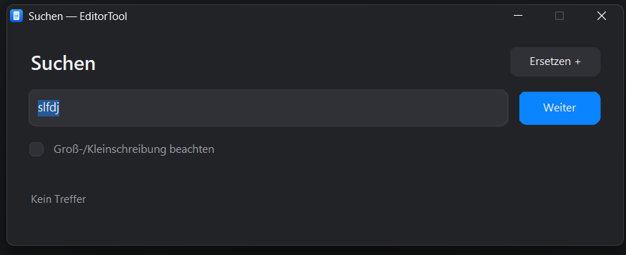

# EditorTool

Ein schlanker nativer Rust-Editor für **Text, Code und Bilder** — für Windows, Linux und macOS, jeweils **x64 und ARM64**.

[Downloads](https://github.com/OnlySecci/EditorTool/releases) · [Release Notes](RELEASE_NOTES.md) · [Changelog](CHANGELOG.md) · [Entwicklung](CONTRIBUTING.md)

*Hauptansicht — vom Projektinhaber bereitgestellte Aufnahme.*

## Neu in V1.1

Zeilenumbruch, Farbschema (Dunkel/Hell/Graphit), Akzentfarbe und Textgrösse lassen sich in den Einstellungen ändern. **Datei → Alle Tabs schliessen** schliesst nach Speicherrückfragen alle Tabs des Fensters. Bilder per Doppelklick in der Anzeige verkleinern (10–100 %); per Rechtsklick Bildaktionen öffnen. Die Bildgrösse bleibt im Dokument und im Sitzungscache erhalten. Nach dem Einfügen bleibt das Bild sichtbar.

## Funktionen

- Mehrere Fenster und Tabs; Tab-Leiste oben oder links. Die vertikale Leiste lässt sich am Trennstrich verbreitern. Ihre Breite bleibt gespeichert.
- Gespeicherte Tabs heißen wie die Datei. Ungespeicherte Tabs verwenden die ersten sechs Wörter; leere Tabs heißen „Text 1“, „Text 2“ usw.
- Text und Bilder untereinander. Bilder über **Bearbeiten → Bild einfügen**, **Strg/Cmd+Umschalt+I** oder die Bild-Zwischenablage einfügen.
- Text und eingebettete Bilder gemeinsam als `.etdoc` speichern. Reine Text- und Code-Dateien bleiben normale UTF-8-Dateien.
- Formatfreies Einfügen und Kopieren von Text; fremde Schriftarten, Farben und HTML-/RTF-Stile werden entfernt.
- Zeilennummern und Statusleiste für Cursor, Zeilen, Zeichen, UTF-8-Bytes, Bilder und Auswahl.
- Kompakte, leicht transparente Suche mit aufklappbarem Ersetzen, einzelnen Treffern und „Alle ersetzen“.
- Textvergleich nebeneinander und lexikalische Syntaxfarben, unter anderem für Python, PowerShell, Rust, JavaScript/TypeScript und JSON.
- Automatische Sitzungswiederherstellung für Fenster, Tabs, ungespeicherte Texte, Bilder, Vergleichstexte und Cursorpositionen.

Suchansicht aus der Entwicklung

Diese bereitgestellte Aufnahme zeigt die Suche vor ihrer Verkleinerung. V1.0 verwendet ein kompakteres Fenster mit 95 % Deckkraft.

## Installation

Downloads unter [Releases](https://github.com/OnlySecci/EditorTool/releases). Das Repository und die Downloads sind **öffentlich** zugänglich.

| System | Pakete für x64 und ARM64 |
| --- | --- |
| Windows | Setup-EXE und portables ZIP |
| Fedora / Nobara | RPM oder Flatpak |
| Ubuntu / Debian | DEB oder Flatpak |
| Weitere Linux-Distributionen | Flatpak oder portables TAR.GZ |
| macOS Intel / Apple Silicon | DMG oder ZIP mit App-Bundle |

**Windows:** Setup installiert für den aktuellen Benutzer unter `%LOCALAPPDATA%/Programs/EditorTool`. Die App erscheint unter **Einstellungen → Apps → Installierte Apps** und als mögliche Standard-App für `.etdoc`. Der Sitzungscache bleibt bei der Deinstallation erhalten.

**Linux:** RPM beziehungsweise DEB über den Paketmanager installieren. Flatpak: `flatpak install --user ./EditorTool-*.flatpak`, danach `flatpak run com.github.OnlySecci.EditorTool`. Der Runtime-Zugang ist im Bundle hinterlegt; eine Veröffentlichung auf Flathub ist damit nicht verbunden. Die native Linux-Version nutzt X11 beziehungsweise XWayland.

**macOS:** DMG öffnen und die App in „Programme“ ziehen. Intel verwendet `x86_64`, Apple Silicon `arm64`.

Die Pakete sind **ohne Windows-/Apple-Entwicklerzertifikat** veröffentlicht. macOS-App-Bundles erhalten eine lokale Ad-hoc-Signatur und sind nicht notarisiert. `SHA256SUMS.txt` enthält die Prüfsummen.

## Sitzung und Dokumente

Änderungen gehen nach etwa 400 ms in einen Hintergrundschreibvorgang. Beim Schließen eines Fensters wird auf die Sicherung gewartet. Das Fenster wird beim nächsten Start wiederhergestellt; ausdrücklich geschlossene Tabs werden nicht wieder geöffnet. Unter Windows lösen normales Herunterfahren und Abmelden zusätzlich eine Sicherung aus.

Der automatische Cache überschreibt keine Originaldateien. „Speichern“ schreibt den linken Text beziehungsweise sein Text-/Bild-Dokument in die gewählte Datei. Vergleichstexte bleiben im Cache erhalten. Bei einem erzwungenen Abbruch kann nur der zuletzt abgeschlossene Stand wiederhergestellt werden. Undo-Verläufe werden nicht gespeichert.

| Plattform | Einstellungen und Cache |
| --- | --- |
| Windows | `%APPDATA%/EditorTool` |
| Linux | `$XDG_CONFIG_HOME/EditorTool`, sonst `~/.config/EditorTool` |
| macOS | `~/Library/Application Support/EditorTool` |
| Portable-Modus | `Data` neben der EXE, wenn dort `portable.txt` liegt |

Der Unterordner `session` enthält Klartext und eingebettete Bilddaten. Weitere Fenster öffnet man über **Datei → Neues Fenster**. Aus dem Dateimanager geöffnete Dateien werden an die bestehende Instanz übergeben.

## Bedienung

Windows/Linux: **Strg**, macOS: **Cmd**.

| Kürzel | Aktion |
| --- | --- |
| Strg/Cmd+T / +N / +W | Tab erstellen / Fenster erstellen / Tab schließen |
| Strg/Cmd+O / +S / +Umschalt+S | Öffnen / Speichern / Speichern unter |
| Strg/Cmd+F / +H | Suchen / Suchen mit Ersetzen |
| F3 | Nächster Treffer |
| Strg/Cmd+Tab / +Umschalt+Tab | Nächster / vorheriger Tab |
| Strg/Cmd+Umschalt+I | Bild einfügen |
| Strg/Cmd+, | Einstellungen |

Suchen, Ersetzen und **Ansicht → Sprache** arbeiten im zuletzt aktiven Textbereich. Bildaktionen zum Entfernen sind per Rechtsklick erreichbar. Textabschnitte vor und nach Bildern besitzen eigene Undo-Verläufe.

## Selbst bauen

[Rust Stable](https://rustup.rs/) ab Version 1.89 installieren. `Cargo.lock` fixiert die Abhängigkeiten. Erste Builds benötigen Netzwerkzugang. Windows mit MSVC baut FLTK aus Quellen und benötigt zusätzlich CMake, Git und die Visual-C++-Werkzeuge für x64 beziehungsweise ARM64. Dazu `CARGO_BUILD_TARGET` auf `x86_64-pc-windows-msvc` beziehungsweise `aarch64-pc-windows-msvc` setzen.

- Windows: `scripts/build-windows.ps1`, danach `scripts/package-windows.ps1 -PortableOnly`. Für lokale Setup-Builds einen vorhandenen NSIS-Compiler über `NSIS_COMPILER` angeben. GitHub erstellt Setup-EXEs mit dem NSIS-Cross-Compiler auf Linux.
- Linux: C++-, X11-, Pango-, Cairo- und Fontconfig-Entwicklungspakete installieren; `bash scripts/build-linux.sh`, anschließend `package-linux.sh` beziehungsweise `package-flatpak.sh` aus `scripts/` ausführen. Die Paketwerkzeuge müssen vorhanden sein.
- macOS: Xcode Command Line Tools und Rust installieren; `bash scripts/build-macos.sh` und `bash scripts/package-macos.sh` ausführen.

Die GitHub-Matrix baut alle sechs System-/Architektur-Kombinationen. Auf Wunsch werden keine Test-Suites ausgeführt.

## Ressourcen und Grenzen

Rust und FLTK statt Browser-Laufzeit. Die Oberfläche wartet im Leerlauf auf Betriebssystem-Ereignisse. Zähler werden inkrementell aktualisiert; Sitzungssicherung und Syntaxfarben verwenden einmalige Timer nach Änderungen. Konkrete RAM-/CPU-Werte wurden nicht gemessen.

Syntaxfarben sind lexikalisch und bleiben über 4 MiB pro Textbereich aus. Der Textvergleich läuft auf Knopfdruck und wird über 16 MiB gröber; Bilder werden nicht visuell verglichen. Bilder werden als PNG eingebettet, maximal 40 Megapixel pro Bild. Bilder erhöhen RAM- und Cache-Bedarf. Zeichenstatistiken zählen Unicode-Codepoints.

## Lizenz

Die eigenen Projektdateien stehen unter **[The Unlicense](LICENSE)**; der Text liegt auch in [UNLICENSE](UNLICENSE). Drittanbieter behalten ihre eigenen Lizenzen, die unter `third-party-licenses` und in den Paketen mitgeliefert werden.

